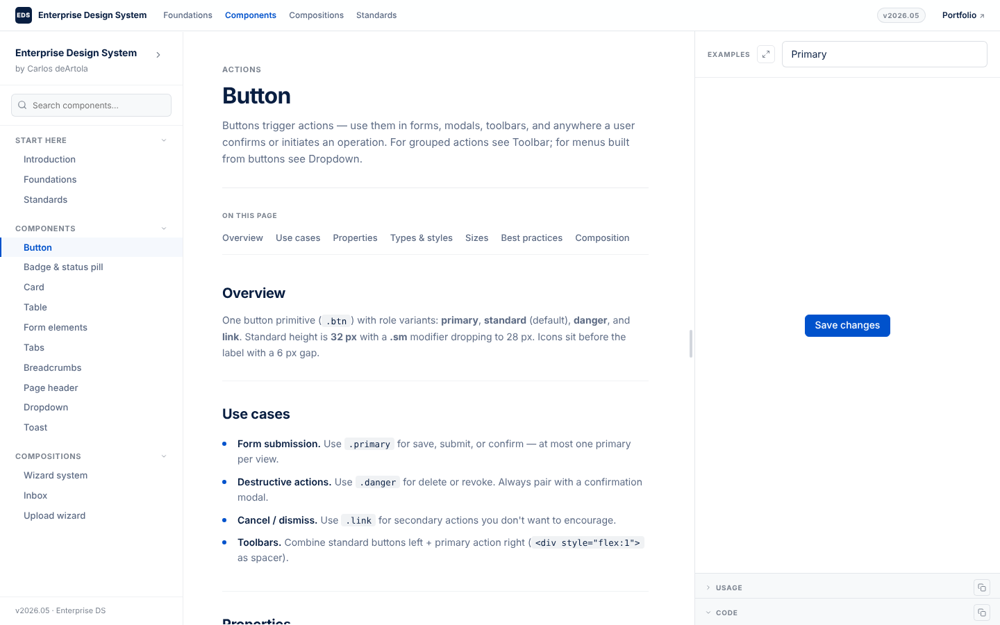

# Enterprise Design System

A hand-authored HTML and CSS design system for dense product UI, where every component page is its own reference implementation. The documentation runtime is written in strict TypeScript.



Live at [doselos.com/design-system](https://doselos.com/design-system).

## What's inside

**Start here:** Introduction, Foundations, Standards. Read these before the components.

**10 components**

- Button
- Badge and status pill
- Card
- Table
- Form elements
- Tabs
- Breadcrumbs
- Page header
- Dropdown
- Toast

**3 compositions**

- Wizard system
- Inbox
- Upload wizard

Each page documents one part: overview, use cases, properties, variants, best practices, and a live example with the markup beside it.

## Four modes

Light, dim, dark, and high-contrast. Every value is a token in `components/_shared/tokens.css`, written in OKLCH, and each mode redefines the tokens, never the components. Set a mode with an attribute on `<html>`, or on any element to scope it to a subtree:

```html
<html data-mode="dark">   <!-- dim, dark, or hc; no attribute means light -->
```

A second axis, `data-accent`, swaps the brand color (blue, indigo, teal, violet, amber, slate) and composes with any mode.

## Design tokens

The tokens are exported as JSON in the [W3C Design Tokens format](https://www.designtokens.org) (DTCG 2025.10), generated from `tokens.css`, which stays the single source of truth:

```
tokens/modes/light.tokens.json      every token for one mode (blue accent)
tokens/modes/dim.tokens.json
tokens/modes/dark.tokens.json
tokens/modes/hc.tokens.json
tokens/accents/<accent>/<mode>.tokens.json   what an accent changes in that mode
tokens/tokens-studio.json           the four modes as Tokens Studio sets and themes
```

Colors keep their exact OKLCH values, with a hex fallback for tools that read hex only. Radii are dimensions, shadows are shadow tokens, and each token records the CSS custom property it comes from. Values that are formulas in the CSS (the dark mode tints are `color-mix()` against a per-mode multiplier) are resolved through the same cascade a browser applies, for every mode and accent.

`tokens-studio.json` holds the four modes as token sets, each a theme in a "Mode" group. Import it into [Tokens Studio](https://tokens.studio) to sync the tokens to Figma variables, one mode per theme.

```sh
npm run tokens   # regenerates tokens/ from components/_shared/tokens.css
```

CI regenerates the tokens on every push and fails when the committed files are out of date.

## Accessibility

Built to WCAG AA. The Standards page sets the rules every component follows: color contrast, focus and keyboard behavior, reduced motion, and screen readers, plus interaction states and voice and tone.

## Run it locally

The pages need no build and no dependencies. Clone the repo and open `index.html` in a browser, or serve the folder:

```sh
python3 -m http.server 8000
# then open http://localhost:8000
```

## The TypeScript runtime

`src/docs.ts` is the script every page loads: it builds the masthead, the sidebar nav with its search and saved state, the related-components chips, the Previous / Next pager, the "On this page" strip, and the example panel (search, code and usage blocks, copy, expand, drag to resize). It compiles to `components/_shared/docs.js`, which is committed so the pages still open straight from disk.

```sh
npm install
npm run typecheck   # strict mode, no emit
npm run build       # writes components/_shared/docs.js
```

Edit `src/docs.ts`, never `docs.js`. CI typechecks every push and fails if the committed `docs.js` doesn't match a fresh build.

## Structure

```
index.html              the landing page
components/*.html       one page per component, composition, and reading page
components/_shared/
  tokens.css            tokens and component styles for all four modes
  docs.css              the documentation page layout
  docs.js               compiled from src/docs.ts; don't edit
src/docs.ts             the documentation runtime, in TypeScript
tokens/                 the design tokens as JSON, generated from tokens.css
tools/tokens/           the token generator, in TypeScript
```

## License

[MIT](LICENSE). Made by [Carlos deArtola](https://doselos.com).
